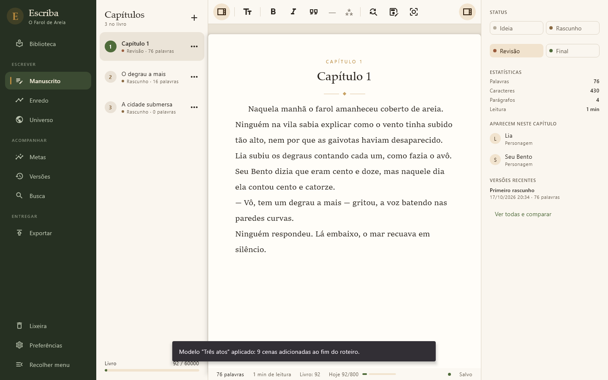

# Escriba

Editor de livros para escritores, em Kotlin Multiplatform + Compose Desktop. Inclui biblioteca de
livros, capítulos com salvamento automático, fichas de universo (personagens, locais, grupos e lore),
metas e produtividade diária, versões com diff, lixeira com retenção, localizar e substituir com regex,
busca no livro inteiro e exportação para Markdown, TXT, HTML e DOCX.

Os livros ficam em `Documentos/Escriba/<Título>.escriba/`, e os dados do app (lixeira, produtividade e
preferências) ficam em `%APPDATA%/Escriba`.

O Manuscrito mostra o texto formatado enquanto você escreve: negrito, itálico, versalete, sobrescrito e
subscrito, títulos (H1–H3), listas, citações, parágrafos centralizados, quebras de cena, imagens e notas de
rodapé, espaço ajustável entre parágrafos (compacto, normal, arejado), com barra flutuante sobre a seleção, partes do livro fora da numeração (prólogo, epílogo…), blocos de
notas e correções ao digitar (`--` vira travessão, `...` vira reticências, aspas curvas). Por baixo, cada
capítulo continua sendo um arquivo Markdown legível (sintaxe em
[Markup.kt](shared/src/commonMain/kotlin/com/cuboide/escriba/core/text/Markup.kt)).

Atalhos: `Ctrl+1`…`Ctrl+7` trocam de seção, `Ctrl+F` localiza/substitui, `Ctrl+Shift+F` busca no livro,
`Ctrl+B`/`Ctrl+I` negrito/itálico, `Ctrl+Z`/`Ctrl+Y` desfazem e refazem (inclusive formatação), `F11` modo foco
(`Esc` sai) e `Ctrl+S` salva.

O relatório da análise que originou estas funcionalidades está em
[docs/engenharia-reversa-autor.md](docs/engenharia-reversa-autor.md).
A comparação funcionalidade por funcionalidade com o Autor, com o caminho até a paridade, está em
[docs/comparacao-escriba-autor.md](docs/comparacao-escriba-autor.md).

---

This is a Kotlin Multiplatform project targeting Desktop (JVM).

* [/shared](./shared/src) is for code that will be shared across your Compose Multiplatform applications.
  It contains several subfolders:
  - [commonMain](./shared/src/commonMain/kotlin) is for code that’s common for all targets.
  - Other folders are for Kotlin code that will be compiled for only the platform indicated in the folder name.
    For example, if you want to use Apple’s CoreCrypto for the iOS part of your Kotlin app,
    the [iosMain](./shared/src/iosMain/kotlin) folder would be the right place for such calls.
    Similarly, if you want to edit the Desktop (JVM) specific part, the [jvmMain](./shared/src/jvmMain/kotlin)
    folder is the appropriate location.

### Running the apps

Use the run configurations provided by the run widget in your IDE's toolbar. You can also use these commands and options:

- Desktop app:
  - Hot reload: `./gradlew :desktopApp:hotRun --auto`
  - Standard run: `./gradlew :desktopApp:run`

### Running tests

Use the run button in your IDE's editor gutter, or run tests using Gradle tasks:

- Desktop tests: `./gradlew :shared:jvmTest`

---

Learn more about [Kotlin Multiplatform](https://www.jetbrains.com/help/kotlin-multiplatform-dev/get-started.html)…